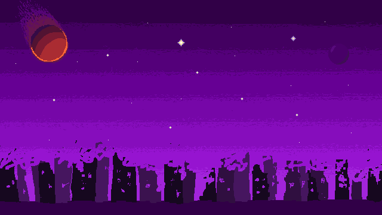
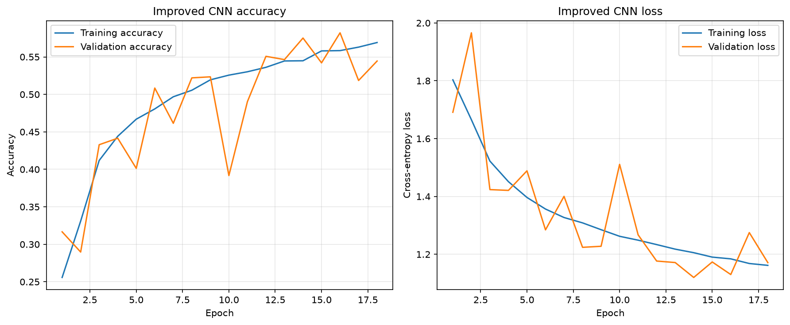
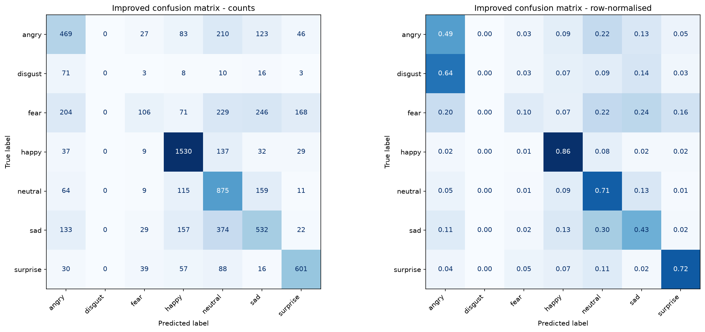

# Spaceweb

Welcome to my little corner of space.

Spaceweb is my personal website, built as an mini explorable pixel-art universe. Launch a spaceship, visit lots of different planet and discover my projects and even try a little machine learning demo inside your browser.

This project started as FaceMl, a facial recognition machine learning project and gradually I felt doing more than that, learning how to setup a proper personal website and how to draw pixel arts.

**[Explore Spaceweb](https://chi-chunl.github.io/Spaceweb/)**



## Explore the universe

You are piloting an animated spaceship with thrust, rotation and momentum. Your objective is just to explore what is out there. Each planet links to different thing for you to explore:

- landing on github planet leads to my own github page.
- landing on youtube planet leads to my youtube page.
- landing on my homeworld leads to a very short intro about myself.
- landing on SpaceML to try out my facial-expression recongition machine learning algorithm.
- Capture your own face inside of the planet and become a astronaut.
- Create and download a personalised StarWeb certificate.
- Keep flying upward into an expanding starfield.
- Turn on the optional background music while exploring.

I drew the entire website's pixel art and animation purely based in Aseprite, including the planets, spaceship, background, cursor and different UI.

## Controls

Click Launch Spaceship to begin

| Control | Action |
| --- | --- |
| W / Up arrow | Thrust forward |
| A / Left arrow | Turn left |
| D / Right arrow | Turn right |
| S / Down arrow | Brake |
| F | Enter a nearby planet |
| Enter | Return keyboard control to the launched spaceship |
| Escape | Pause flight or leave SpaceML |

## SpaceML

SpaceML classifies visible facial expressions into seven categories:

**Angry · Disgust · Fear · Happy · Neutral · Sad · Surprise**

It estimates facial-expression categories; it cannot determine how someone truly feels.

The demo supports:

- Webcam face detection and expression prediction.
- Live probability bars for all seven classes.
- Image uploads.
- Astronaut portrait capture.

For uploaded images, use a tightly cropped photo of one face. Automatic face detection currently applies to the webcam pipeline.

### How prediction even works for my website

```text
Webcam frame -> Detect one face -> Crop and resize to 48x 48 -> Convert to greyscale -> CNN -> seven probabilities
```

The model accepts greyscale pixel values from 0-255 and handles all normalisation internally.

Custom CNN uses three convolution block with 32, 64, 128 filters, batch normalisation, ReLU, pooling and dropout. Global average pooling then feeds a dense layer and a softmax output.

### Model results

These are saved Python evaluation results on the 7178 images for FER-2013 test set.

| Model | Test accuracy | Macro F1 | Parameters |
| --- | ---: | ---: | ---: |
| Baseline CNN | 53.61% | 0.4491 | 683,527 |
| Improved CNN | 57.30% | 0.4513 | 305,191 |

Macro F1 gives each expression class equal importance. The small change in macro F1 shows why the increase in accuracy does not tell the whole story.

Performance is uneven across expressions, especially fear and disgust. Lighting, face angle, occlusion and differences between webcam images and training data also affect predictions.

The main browser demo uses the exported improved custom CNN . Additional python scripts are used for data augmentation, class weights, ExpW data expansion, transfer learning and grad-CAM





Detailed reports are saved in `results/baseline_metrics.json` and `results/improved_metrics.json`.

## Run locally

Use Node.js 24 and npm. Python is not required to run the website.

```bash
git clone https://github.com/Chi-ChunL/Spaceweb.git
cd Spaceweb/website
npm ci
npm run dev
```

Open the local URL printed in your terminal.

In Windows PowerShell, you can use `npm.cmd` instead of `npm`.

To preview the production build:

```bash
npm run build
npm run preview
```

Camera access requires browser permission. Use localhost for development or HTTPS when deployed.

## Deployment

Pushes to `main` trigger the GitHub Actions workflow, which installs dependencies, builds the website and publishes `website/dist` to GitHub Pages.

The Vite base path is `/Spaceweb/`.

## Credits

- Website and pixel art: ChiChi.
- Music: [Adventure](https://disasterpeace.bandcamp.com/track/adventure) by Disasterpeace, from the FEZ OST. The artist's listing specifies all rights reserved.
- Font: Pixelify Sans, served through Google Fonts.
- Facial-expression training data: FER-2013, with ExpW used in additional experiments.

## Find me

- [GitHub](https://github.com/Chi-ChunL)
- [YouTube](https://www.youtube.com/@austinlin8577)

Thanks for visiting. Feel free to explore the boundless space.